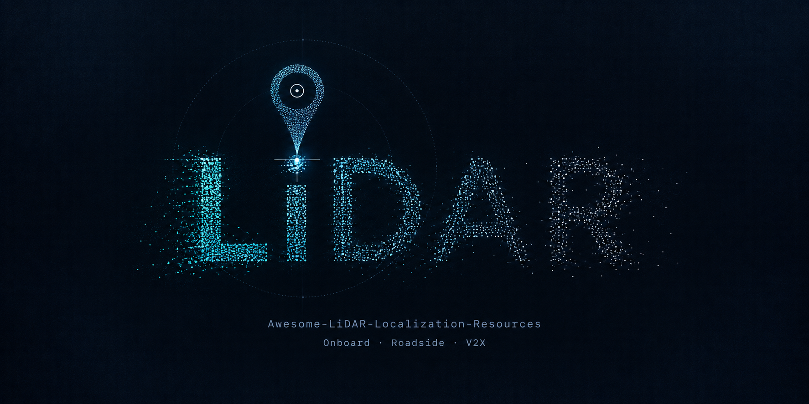
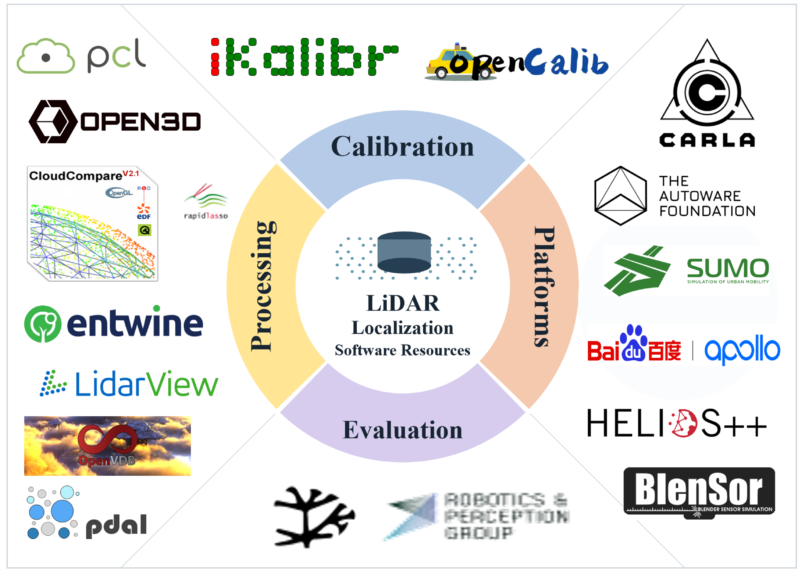
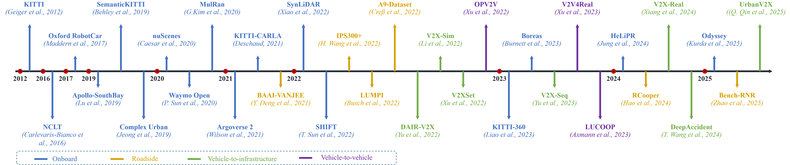

# Awesome-LiDAR-Localisation-Resources

This repository provides LiDAR localisation resources for connected and automated vehicles (CAVs), curated at Southeast University in Nanjing, China.
It offers selected resources for researchers and practitioners interested in LiDAR localisation, including sensor selection, software tools, localisation algorithms, open datasets and practical tutorials.
This work is supported by the Sino-UK Centre for Intelligent Mobility at Southeast University.
If you find this repository useful, please consider giving it a star ⭐ or sharing it 👋.

> [!NOTE]
> If you notice a missing resource or discover something new, please open an issue or submit a pull request. We welcome your contributions to this repository.

> The price bands, ranges and channel counts in the table are indicative figures drawn from public information, intended for comparison rather than procurement advice. Products evolve rapidly; consult the manufacturer’s latest specifications and automotive qualification information before deployment.

## Contents

- [1. Hardware selection](#hardware)
  - [1.1 LiDAR types](#selection)
  - [1.2 Procurement and drivers](#drivers)
- [2. Software resources](#software)
  - [2.1 Calibration: onboard and cooperative](#calibration)
  - [2.2 Point cloud processing: general-purpose and specialised](#processing)
  - [2.3 Software platforms: real vehicles and simulation](#platforms)
  - [2.4 Evaluation tools](#evaluation)
- [3. Localisation algorithms](#algorithms)
  - [3.1 Onboard](#onboard)
  - [3.2 Cooperative](#cooperative)
    - [Vehicle-to-vehicle cooperation](#v2v)
    - [Vehicle-to-infrastructure cooperation](#v2i)
    - [Vehicle–infrastructure–cloud cooperation](#vic)
- [4. Public datasets](#datasets)
  - [4.1 Real-world onboard data](#data-onboard-real)
  - [4.2 Simulated onboard data](#data-onboard-sim)
  - [4.3 Real-world roadside data](#data-roadside)
  - [4.4 Real-world vehicle–infrastructure data](#data-v2i-real)
  - [4.5 Simulated vehicle–infrastructure / multi-node data](#data-v2i-sim)
  - [4.6 Real-world and simulated vehicle-to-vehicle data](#data-v2v)
  - [4.7 Dataset selection](#data-selection)
- [5. Open-source communities, white papers and standards](#practice)
  - [5.1 Open-source communities](#communities)
  - [5.2 White papers and technical reports](#reports)
  - [5.3 Standards and specifications](#standards)
- [Contributing and citation](#contributing)

## 1. Hardware selection

Sensor configuration shapes the design of a localisation system. Surround or forward coverage, long-range point density, near-field blind spots and installation requirements all influence calibration, odometry and map matching. The table below summarises common production technologies by scanning mechanism.

### 1.1 LiDAR types

| Type | Scanning mechanism | Typical FOV | Channels / equivalent channels | Range at 10% reflectivity (indicative) | Point cloud pattern | Onboard primary sensor | Onboard blind-spot coverage | Roadside use | Price band (CNY) | Representative brands |
| --------------- | ----------------------------- | ----------------------------------------- | ----------------------------------- | ---------------------------------------------- | ------------------------------------- | ------------------------------- | -------------------- | ------------------- | -------- | ------------------------- |
| Mechanical | Rotating transmitter and receiver assembly | H ≈ 360°; V depends on channel configuration | 16–128 physical channels | 100–200 m; flagship models >200 m; short-range surround models ≈20–40 m | Layered rings; increasingly sparse at long range | Suitable; common in robotaxis and advanced demonstrations | Less common as a dedicated blind-spot sensor | Common | Tens of thousands | Hesai, Ouster, RoboSense |
| Semi-solid-state · rotating mirror | Fixed transmitter/receiver; rotating mirror | Forward-facing, ≈120° × 20°–25° | Typically 128 physical channels; flagship models ≈192–256 | Typically 150–230 m; some models 250–300 m | Forward sector; sparser at long range; seamless within one FOV | Common for forward long-range sensing | Usually not used alone for very close-range coverage | Some junctions and forward-facing pole installations | Thousands | Hesai, Innovusion, Huawei, Valeo |
| Semi-solid-state · MEMS | Fixed transmitter/receiver; micro-mirror scanning | Forward-facing, ≈120° × 25° | ≈120–200 equivalent channels; denser scanning within the ROI | Typically 150–200 m | Forward sector; sparser at long range | Forward-facing primary sensor | Product-dependent | Less common | Thousands | RoboSense, Innoviz |
| Semi-solid-state · prism | Fixed transmitter/receiver; prism or optical-wedge scanning | Forward sector; varies substantially by product | E.g. Livox HAP: ≈144 equivalent channels | ≈90–150 m | Non-repetitive / petal pattern; sparser at long range and near the edges | Suitable with support for non-repetitive scanning | Suitable | Less common for conventional junction installations | Thousands | Livox |
| Fully solid-state · Flash | No macroscopic motion; area illumination / electronic scanning | Camera-like; blind-spot models up to 100° × 75° or wider | Area-array equivalent of tens to around 100–200 channels | ≈20–50 m; typically ≈20–30 m for blind-spot sensing | Relatively regular near-field depth map; degrades rapidly with range | Not a long-range primary sensor | Suitable | Near-field coverage and junction blind spots | Thousands | Hesai, RoboSense, Huawei |
| Fully solid-state · OPA | Electronic beam steering | Programmable sector | Determined by array channels | Automotive long-range capability still developing | Depends on array and scanning strategy | Limited production deployment | — | Research / pilots | — | Analog Photonics, Luowei |

**Table notes**

- The onboard primary, blind-spot and roadside applications shown are typical uses rather than strict limits. Mechanical 360° LiDARs remain widely used in robotaxis, high-precision mapping and roadside installations; rotating-mirror and MEMS designs are common choices for forward-facing passenger-car systems.
- Roadside installations place greater emphasis on mounting height and tilt, combined coverage from multiple sensors, long-term online calibration, weather, contamination and maintenance than on automotive vibration profiles.
- Non-repetitive scanning, as used by some Livox sensors, is less compatible with conventional odometry that relies on scan-ring-based deskewing. It requires per-point timestamps or a dedicated front end.
- Long-range OPA and fully solid-state technologies are still developing. They are included for completeness and are not recommended as the sole sensor assumption for a baseline localisation system.

### Selection considerations

1. **Define the task before selecting the sensor.** High-precision mapping and global localisation require sufficient geometric structure and stable extrinsic calibration. Forward-facing localisation at high speed depends more on long-range resolution, while roadside tracking at junctions relies on near-field coverage and multisensor time synchronisation.
2. **Check drivers and timestamps.** Confirm official ROS / ROS 2 support, whether timestamps are provided per point or per frame, and whether IMU intrinsic parameters are available. These affect compatibility with open-source systems such as FAST-LIO2, LIO-SAM and KISS-ICP.
3. **Plan calibration during sensor selection.** Arrange the calibration space and tools for multi-LiDAR, LiDAR–IMU, LiDAR–camera and V2I extrinsics at this stage (see Section 2), rather than after delivery.
4. **Account for the differences between roadside and onboard installations.**
   Roadside LiDARs are approximately stationary and suit background mapping and object tracking. Onboard LiDARs move with the vehicle and require motion compensation and attention to changes in extrinsic calibration.

### 1.2 Procurement and drivers

Sensors can be purchased from manufacturers or authorised distributors. Once a model has been selected, find its driver on the manufacturer’s support pages or official GitHub organisation, and check the supported operating systems, ROS versions, firmware and sensor models.

| Manufacturer | Products / procurement | Official open-source driver | Checks before purchase |
| ------------------ | --------------------------------- | ------------------------------------------------------------------------------------------ | ------------------------------------------------- |
| Hesai | [Official website](https://www.hesaitech.com/) | [HesaiTechnology/HesaiLidar_ROS_2.0](https://github.com/HesaiTechnology/HesaiLidar_ROS_2.0) | Model, firmware and ROS branch compatibility |
| RoboSense | [Official website](https://www.robosense.ai/) | [RoboSense-LiDAR/rslidar_sdk](https://github.com/RoboSense-LiDAR/rslidar_sdk) | Point types, per-point timestamps, synchronisation and network settings |
| Livox | [Official website](https://www.livoxtech.com/) | [Livox-SDK/livox_ros_driver2](https://github.com/Livox-SDK/livox_ros_driver2) | Driver 2 support for the device, message formats and IMU output |
| Ouster | [Official website](https://ouster.com/) | [ouster-lidar/ouster-ros](https://github.com/ouster-lidar/ouster-ros) | Device generation, firmware, scan configuration and time synchronisation interfaces |

After installing the driver, follow these steps:

1. Connect power and Ethernet as specified in the device manual, and configure the IP addresses of the sensor and acquisition computer.
2. Follow the driver README to install dependencies and build the software, then configure the model, ports and calibration file paths.
3. Start the driver and check the point cloud topic, frame rate, coordinate frame and timestamps. For devices with an IMU, also check the IMU output.
4. Record a short sequence to check for packet loss and confirm that the network and storage can sustain the acquisition rate.

> Once the driver is working, use RViz or the manufacturer’s software to inspect live point clouds and check their orientation, range and coverage. Saved point clouds can be inspected in CloudCompare or Open3D. Store subsequent calibration results alongside the device model, mounting position and driver configuration. Complete these checks before collecting the main dataset, and recalibrate after changing sensor positions. Common tools are listed in the software resources section.

## 2. Software resources

### 2.1 Calibration

#### Onboard calibration

Tools for spatial and temporal calibration of LiDAR–IMU, LiDAR–camera and multi-LiDAR systems.

| Software | Paper | Repository |
| -------------------------------- | ------------------------------------------------------ | -------------------------------------------------------------------------------------------------- |
| LI-Calib | [Paper](https://arxiv.org/abs/2007.14759) | [APRIL-ZJU/lidar_IMU_calib](https://github.com/APRIL-ZJU/lidar_IMU_calib) |
| OA-LICalib | [Paper](https://arxiv.org/abs/2205.03276) | [APRIL-ZJU/OA-LICalib](https://github.com/APRIL-ZJU/OA-LICalib) |
| Multi-LiCa | [Paper](https://doi.org/10.1109/MFI62651.2024.10705773) | [TUMFTM/Multi_LiCa](https://github.com/TUMFTM/Multi_LiCa) |
| FAST-Calib | [Paper](https://arxiv.org/abs/2507.17210) | [hku-mars/FAST-Calib](https://github.com/hku-mars/FAST-Calib) |
| iKalibr | [Paper](https://arxiv.org/abs/2407.11420) | [Unsigned-Long/iKalibr](https://github.com/Unsigned-Long/iKalibr) |
| OpenCalib | [Paper](https://doi.org/10.1016/j.simpa.2022.100393) | [PJLab-ADG/SensorsCalibration](https://github.com/PJLab-ADG/SensorsCalibration) |
| LB-L2L-Calib 2.0 | [Paper](https://doi.org/10.1109/IROS55552.2023.10342245) | —— |
| LI-Init | [Paper](https://doi.org/10.1109/IROS47612.2022.9982225) | [hku-mars/LiDAR_IMU_Init](https://github.com/hku-mars/LiDAR_IMU_Init) |
| direct visual–LiDAR calibration | [Paper](https://arxiv.org/abs/2302.05094) | [koide3/direct_visual_lidar_calibration](https://github.com/koide3/direct_visual_lidar_calibration) |

#### Cooperative calibration

Tools for coordinate alignment between vehicle and infrastructure observations or across multiple nodes.

| Software | Paper | Repository |
| ----------- | ------------------------------------------------------------- | -------------------------------------------------------------- |
| V2I-Calib | [Paper](https://ieeexplore.ieee.org/abstract/document/10802098) | [MassimoQu/v2i-calib](https://github.com/MassimoQu/v2i-calib) |
| V2X-Reg++ | [Paper](https://arxiv.org/abs/2410.11008) | [MassimoQu/v2i-calib](https://github.com/MassimoQu/v2i-calib) |
| MamV2XCalib | [Paper](https://arxiv.org/abs/2507.23595) | [zhuyaoye/MamV2XCalib](https://github.com/zhuyaoye/MamV2XCalib) |

### 2.2 Point cloud processing

#### General-purpose tools

Tools for point cloud input/output, filtering, registration, compression, map storage and visualisation.

| Software | Paper | Repository |
| ------------- | -------------------------------------------------- | ---------------------------------------------------------------------------------------- |
| PCL | [Paper](https://doi.org/10.1109/ICRA.2011.5980567) | [PointCloudLibrary/pcl](https://github.com/PointCloudLibrary/pcl) |
| Open3D | [Paper](https://arxiv.org/abs/1801.09847) | [isl-org/Open3D](https://github.com/isl-org/Open3D) |
| PDAL | [Paper](https://doi.org/10.1016/j.cageo.2020.104680) | [PDAL/PDAL](https://github.com/PDAL/PDAL) |
| LASzip | [Paper](https://doi.org/10.14358/PERS.79.2.209) | [LASzip/LASzip](https://github.com/LASzip/LASzip) |
| CloudCompare | —— | [CloudCompare/CloudCompare](https://github.com/CloudCompare/CloudCompare) |
| Entwine | —— | [connormanning/entwine](https://github.com/connormanning/entwine) |
| OpenVDB | [Paper](https://doi.org/10.1145/2487228.2487235) | [AcademySoftwareFoundation/openvdb](https://github.com/AcademySoftwareFoundation/openvdb) |
| OctoMap | [Paper](https://doi.org/10.1007/s10514-012-9321-0) | [OctoMap/octomap](https://github.com/OctoMap/octomap) |
| RViz (ROS 2) | —— | [ros2/rviz](https://github.com/ros2/rviz) |
| LidarView | —— | [Project / resource page](https://gitlab.kitware.com/LidarView/lidarview) |

#### Specialised tools

Patchwork++, TRAVEL and CSF support ground processing; Removert, ERASOR and Dynablox handle dynamic points; distortion_corrector and VICET address motion distortion; OpenPCDet and MMDetection3D provide 3D object detection tools.

| Software | Paper | Repository |
| ----------------------------- | --------------------------------------------------------------------------- | ---------------------------------------------------------------------------------------------- |
| Patchwork++ | [Paper](https://arxiv.org/abs/2207.11919) | [url-kaist/patchwork-plusplus](https://github.com/url-kaist/patchwork-plusplus) |
| TRAVEL | [Paper](https://arxiv.org/abs/2206.03190) | [url-kaist/TRAVEL](https://github.com/url-kaist/TRAVEL) |
| CSF | [Paper](https://doi.org/10.3390/rs8060501) | [jianboqi/CSF](https://github.com/jianboqi/CSF) |
| Dynablox | [Paper](https://arxiv.org/abs/2304.10049) | [ethz-asl/dynablox](https://github.com/ethz-asl/dynablox) |
| Removert | [Paper](https://doi.org/10.1109/IROS45743.2020.9340856) | [gisbi-kim/removert](https://github.com/gisbi-kim/removert) |
| ERASOR | [Paper](https://arxiv.org/abs/2103.04316) | [LimHyungTae/ERASOR](https://github.com/LimHyungTae/ERASOR) |
| Autoware distortion_corrector | —— | [autowarefoundation/autoware_universe](https://github.com/autowarefoundation/autoware_universe) |
| VICET | [doi.org/10.1109/LRA.2023.3346753](https://doi.org/10.1109/LRA.2023.3346753) | [mcdermatt/VICET](https://github.com/mcdermatt/VICET) |
| OpenPCDet | —— | [open-mmlab/OpenPCDet](https://github.com/open-mmlab/OpenPCDet) |
| MMDetection3D | —— | [open-mmlab/mmdetection3d](https://github.com/open-mmlab/mmdetection3d) |

### 2.3 Software platforms

#### Real-vehicle platforms

| Software | Paper | Repository |
| ----------------------- | ------------------------------------------ | ---------------------------------------------------------------------------------- |
| Autoware | [Paper](https://doi.org/10.1109/MM.2015.133) | [autowarefoundation/autoware](https://github.com/autowarefoundation/autoware) |
| Apollo | —— | [ApolloAuto/apollo](https://github.com/ApolloAuto/apollo) |
| hdl_global_localization | —— | [koide3/hdl_global_localization](https://github.com/koide3/hdl_global_localization) |

#### Simulation platforms

| Software | Paper | Repository |
| ----------------- | ------------------------------------------------------------ | ---------------------------------------------------------------------------- |
| CARLA | [Paper](https://proceedings.mlr.press/v78/dosovitskiy17a.html) | [carla-simulator/carla](https://github.com/carla-simulator/carla) |
| SUMO | [Paper](https://doi.org/10.1109/ITSC.2018.8569938) | [eclipse-sumo/sumo](https://github.com/eclipse-sumo/sumo) |
| OpenCDA | [Paper](https://arxiv.org/abs/2107.06260) | [ucla-mobility/OpenCDA](https://github.com/ucla-mobility/OpenCDA) |
| AWSIM | —— | [tier4/AWSIM](https://github.com/tier4/AWSIM) |
| V2X E2E Simulator | —— | [tlab-wide/V2X_E2E_Simulator](https://github.com/tlab-wide/V2X_E2E_Simulator) |
| HELIOS++ | [Paper](https://doi.org/10.1016/j.rse.2021.112772) | [3dgeo-heidelberg/helios](https://github.com/3dgeo-heidelberg/helios) |
| BlenSor | [Paper](https://doi.org/10.1007/978-3-642-24031-7_20) | [mgschwan/blensor](https://github.com/mgschwan/blensor) |

CARLA and AWSIM simulate driving environments; OpenCDA and V2X E2E Simulator support cooperative systems; HELIOS++ and BlenSor simulate laser scanning. SUMO provides traffic simulation and can be combined with 3D simulators.

### 2.4 Evaluation tools

| Software | Paper | Repository |
| ------------------------- | ------------------------------------------------------------- | ---------------------------------------------------------------------------------------- |
| evo | —— | [MichaelGrupp/evo](https://github.com/MichaelGrupp/evo) |
| rpg_trajectory_evaluation | [Paper](https://rpg.ifi.uzh.ch/docs/IROS18_Zhang.pdf) | [uzh-rpg/rpg_trajectory_evaluation](https://github.com/uzh-rpg/rpg_trajectory_evaluation) |
| KITTI Odometry Evaluation | [Paper](https://www.cvlibs.net/publications/Geiger2012CVPR.pdf) | [Project / resource page](https://www.cvlibs.net/datasets/kitti/eval_odometry.php) |

## 3. Localisation algorithms

Methods are grouped into onboard and cooperative approaches, with each table ordered by year. The descriptions indicate their roles in localisation, mapping, place recognition or cooperative perception.

### 3.1 Onboard

| Method | Year | Key features | Paper | Source code |
| ------------------- | ---- | -------------------------------------------------------------- | ----------------------------------------------------------------------------------------------------------------------------------------------------------- | ---------------------------------------------------------------------------------------------------------- |
| Levinson et al. | 2007 | Reflectance grid, scan-to-map matching | [Paper](https://doi.org/10.15607/RSS.2007.III.016) | —— |
| LOAM | 2014 | Edge/plane features, point-to-line/plane odometry | [Paper](https://doi.org/10.15607/RSS.2014.X.007) | [laboshinl/loam_velodyne](https://github.com/laboshinl/loam_velodyne) (community port) |
| Autoware NDT | 2015 | NDT scan-to-map matching, onboard localisation module | [doi.org/10.1109/MM.2015.133](https://doi.org/10.1109/MM.2015.133) | [autowarefoundation/autoware](https://github.com/autowarefoundation/autoware) |
| Cartographer | 2016 | Submap matching, loop-closure optimisation | [Paper](https://doi.org/10.1109/ICRA.2016.7487258) | [cartographer-project/cartographer](https://github.com/cartographer-project/cartographer) |
| Akai et al. | 2017 | 3D NDT matching, road-marker constraints | [Paper](https://doi.org/10.1109/IVS.2017.7995900) | —— |
| Wolcott and Eustice | 2017 | Multi-resolution Gaussian mixture maps, intensity–height localisation | [Paper](https://doi.org/10.1177/0278364917696568) | —— |
| Aldibaja et al. | 2017 | Intensity-edge matching, snow-covered and wet roads | [Paper](https://doi.org/10.1109/TII.2017.2713836) | —— |
| IMLS-SLAM | 2018 | Scan-to-surface IMLS matching, low-drift mapping | [Paper](https://arxiv.org/abs/1802.08633) | —— |
| SuMa | 2018 | Surfel map, local geometry updates | [Paper](https://www.roboticsproceedings.org/rss14/p16.html) | [jbehley/SuMa](https://github.com/jbehley/SuMa) |
| Scan Context | 2018 | Bird’s-eye ring-sector descriptor, place retrieval | [Paper](https://doi.org/10.1109/IROS.2018.8593953) | [gisbi-kim/scancontext](https://github.com/gisbi-kim/scancontext) |
| PointNetVLAD | 2018 | Learned point features, global aggregation for place recognition | [Paper](https://arxiv.org/abs/1804.03492) | [mikacuy/pointnetvlad](https://github.com/mikacuy/pointnetvlad) |
| LeGO-LOAM | 2018 | Ground segmentation, lightweight feature-based odometry and mapping | [Paper](https://doi.org/10.1109/IROS.2018.8593950) | [RobustFieldAutonomyLab/LeGO-LOAM](https://github.com/RobustFieldAutonomyLab/LeGO-LOAM) |
| Apollo localisation | 2018 | GNSS–IMU fusion, LiDAR map matching | [doi.org/10.1109/ICRA.2018.8461251](https://doi.org/10.1109/ICRA.2018.8461251) | [ApolloAuto/apollo](https://github.com/ApolloAuto/apollo) |
| SuMa++ | 2019 | Semantic surfels, static–dynamic separation | [Paper](https://doi.org/10.1109/IROS40897.2019.8967704) | [PRBonn/semantic_suma](https://github.com/PRBonn/semantic_suma) |
| L3-Net | 2019 | Learned descriptors, 3D pose cost volume | [Paper](https://openaccess.thecvf.com/content_CVPR_2019/html/Lu_L3-Net_Towards_Learning_Based_LiDAR_Localization_for_Autonomous_Driving_CVPR_2019_paper.html) | —— |
| LO-Net | 2019 | Learned scan-to-scan motion, sparse dynamic clouds | [Paper](https://arxiv.org/abs/1904.08242) | —— |
| LIO-mapping | 2019 | Tight LiDAR–IMU residuals, joint LIO optimisation | [Paper](https://arxiv.org/abs/1904.06993) | [hyye/lio-mapping](https://github.com/hyye/lio-mapping) |
| Removert | 2020 | Multi-resolution range images, remove-then-revert mapping | [Paper](https://doi.org/10.1109/IROS45743.2020.9340856) | [gisbi-kim/removert](https://github.com/gisbi-kim/removert) |
| OverlapNet | 2020 | Overlap and relative-yaw prediction, loop-candidate selection | [Paper](https://www.ipb.uni-bonn.de/wp-content/papercite-data/pdf/chen2020rss.pdf) | [PRBonn/OverlapNet](https://github.com/PRBonn/OverlapNet) |
| DeepLO | 2020 | Unsupervised geometry-aware network, ICP-in-the-loop | [Paper](https://doi.org/10.1109/ICRA40945.2020.9197366) | —— |
| LINS | 2020 | Iterated ESKF, repeated feature correspondences | [Paper](<https://github.com/ChaoqinRobotics/LINS---LiDAR-inertial-SLAM/blob/master/LINS%20preprint.pdf>) | [ChaoqinRobotics/LINS---LiDAR-inertial-SLAM](https://github.com/ChaoqinRobotics/LINS---LiDAR-inertial-SLAM) |
| LIO-SAM | 2020 | Factor-graph LIO, IMU-preintegration smoothing | [Paper](https://doi.org/10.1109/IROS45743.2020.9341176) | [TixiaoShan/LIO-SAM](https://github.com/TixiaoShan/LIO-SAM) |
| ERASOR | 2021 | Pseudo-occupancy ratio, dynamic-object removal | [Paper](https://arxiv.org/abs/2103.04316) | [LimHyungTae/ERASOR](https://github.com/LimHyungTae/ERASOR) |
| Liu et al. | 2021 | NDT scan-to-map, GNSS-denied localisation | [Paper](https://doi.org/10.1051/e3sconf/202125702055) | —— |
| SSC | 2021 | Semantic Scan Context, large-scale place recognition | [Paper](https://doi.org/10.1109/IROS51168.2021.9635904) | [lilin-hitcrt/SSC](https://github.com/lilin-hitcrt/SSC) |
| F-LOAM | 2021 | Two-stage undistortion, non-iterative feature matching | [Paper](https://doi.org/10.1109/IROS51168.2021.9636655) | [wh200720041/floam](https://github.com/wh200720041/floam) |
| LVI-SAM | 2021 | Visual–LiDAR–inertial constraints, smoothing and mapping | [Paper](https://doi.org/10.1109/ICRA48506.2021.9561996) | [TixiaoShan/LVI-SAM](https://github.com/TixiaoShan/LVI-SAM) |
| PWCLO-Net | 2021 | Hierarchical feature embedding, mask optimisation for odometry | [doi.org/10.1109/CVPR46437.2021.01565](https://doi.org/10.1109/CVPR46437.2021.01565) | [IRMVLab/PWCLONet](https://github.com/IRMVLab/PWCLONet) |
| VoxelMap | 2022 | Hash–octree voxels, on-demand plane mapping | [Paper](https://arxiv.org/abs/2109.07082) | [hku-mars/VoxelMap](https://github.com/hku-mars/VoxelMap) |
| LT-mapper | 2022 | Multi-session alignment, change detection and incremental map updates | [Paper](https://arxiv.org/abs/2107.07712) | [gisbi-kim/lt-mapper](https://github.com/gisbi-kim/lt-mapper) |
| Scan Context++ | 2022 | Lateral-offset robustness, semi-metric loop pose | [Paper](https://arxiv.org/abs/2109.13494) | [gisbi-kim/scancontext_tro](https://github.com/gisbi-kim/scancontext_tro) |
| LCDNet | 2022 | Shared encoder, joint loop detection and registration | [Paper](https://doi.org/10.1109/TRO.2022.3150683) | [robot-learning-freiburg/LCDNet](https://github.com/robot-learning-freiburg/LCDNet) |
| OverlapTransformer | 2022 | Range-image descriptors, rotation-invariant place recognition | [Paper](https://arxiv.org/abs/2203.03397) | [haomo-ai/OverlapTransformer](https://github.com/haomo-ai/OverlapTransformer) |
| UnDeepLIO | 2022 | Unsupervised deep LIO, IMU-initialised pose | [Paper](https://arxiv.org/abs/2109.01533) | —— |
| CT-ICP | 2022 | Continuous-time motion modelling, joint registration and deskewing | [Paper](https://doi.org/10.1109/ICRA46639.2022.9811849) | [jedeschaud/ct_icp](https://github.com/jedeschaud/ct_icp) |
| FAST-LIO2 | 2022 | Tightly coupled iterated filtering, direct point registration and incremental mapping | [Paper](https://doi.org/10.1109/TRO.2022.3141876) | [hku-mars/FAST_LIO](https://github.com/hku-mars/FAST_LIO) |
| FAST-LIVO | 2022 | Tightly coupled direct visual and LiDAR–inertial estimation | [Paper](https://doi.org/10.1109/IROS47612.2022.9981107) | [hku-mars/FAST-LIVO](https://github.com/hku-mars/FAST-LIVO) |
| SHINE-Mapping | 2023 | Hierarchical neural features, implicit continuous mapping | [Paper](https://arxiv.org/abs/2210.02299) | [PRBonn/SHINE_mapping](https://github.com/PRBonn/SHINE_mapping) |
| NeRF-LOAM | 2023 | Neural surface representation, joint odometry and meshing | [Paper](https://arxiv.org/abs/2303.10709) | [JunyuanDeng/NeRF-LOAM](https://github.com/JunyuanDeng/NeRF-LOAM) |
| BEVPlace | 2023 | BEV image descriptors, LiDAR place recognition | [Paper](https://arxiv.org/abs/2302.14325) | [zjuluolun/BEVPlace](https://github.com/zjuluolun/BEVPlace) (includes BEVPlace++) |
| KISS-ICP | 2023 | Point-to-point ICP, adaptive correspondence threshold | [Paper](https://doi.org/10.1109/LRA.2023.3236571) | [PRBonn/kiss-icp](https://github.com/PRBonn/kiss-icp) |
| STD | 2023 | Stable triangle descriptors, place recognition and relative pose estimation | [Paper](https://doi.org/10.1109/ICRA48891.2023.10160413) | [hku-mars/STD](https://github.com/hku-mars/STD) |
| PIN-SLAM | 2024 | Deformable neural points, loop-consistent implicit map | [Paper](https://www.ipb.uni-bonn.de/wp-content/papercite-data/pdf/pan2024tro.pdf) | [PRBonn/PIN_SLAM](https://github.com/PRBonn/PIN_SLAM) |
| ALIVE-LIO | 2026 | Learned inertial velocity, degeneracy-aware ESKF fusion | [Paper](https://arxiv.org/abs/2604.02706) | [cocel-postech/alive-lio](https://github.com/cocel-postech/alive-lio) |

### 3.2 Cooperative

#### Vehicle-to-vehicle cooperation

| Method | Year | Key features | Paper | Source code |
| ---------- | ---- | ---------------------------------------------------------------- | --------------------------------------------------------- | ---------------------------------------------------------------------------------------- |
| Soatti et al. | 2018 | Implicit cooperative positioning, shared landmarks | [Paper](https://doi.org/10.1109/TITS.2018.2794405) | —— |
| V2VNet | 2020 | Intermediate feature maps, spatial graph aggregation | [Paper](https://arxiv.org/abs/2008.07519) | [CoPerception](https://github.com/coperception/coperception) (third-party implementation) |
| Héry et al. | 2021 | Neighbour-shape ICP, decentralised GNSS–LiDAR fusion | [Paper](https://doi.org/10.1002/rob.22004) | —— |
| Where2comm | 2022 | Spatial confidence maps, selective feature sharing | [Paper](https://arxiv.org/abs/2209.12836) | [MediaBrain-SJTU/Where2comm](https://github.com/MediaBrain-SJTU/Where2comm) |
| DiSCo-SLAM | 2022 | Scan Context exchange, cross-vehicle loop closure | [Paper](https://doi.org/10.1109/LRA.2021.3138156) | [RobustFieldAutonomyLab/DiSCo-SLAM](https://github.com/RobustFieldAutonomyLab/DiSCo-SLAM) |
| Cao et al. | 2023 | Sparse LiDAR V2X features, real-vehicle loop constraints | [Paper](https://doi.org/10.1109/IROS55552.2023.10341513) | —— |
| DCL-SLAM | 2024 | LiDAR-Iris descriptor, distributed false-loop rejection | [Paper](https://arxiv.org/abs/2210.11978) | [zhongshp/DCL-SLAM](https://github.com/zhongshp/DCL-SLAM) |
| CLS-MPNN | 2024 | Box-and-pose upload, edge joint tracking | [Paper](https://doi.org/10.1109/TSP.2024.3377375) | —— |
| C-SLAMMODT | 2024 | Cooperative factor graph, SLAM with object tracking | [Paper](https://doi.org/10.1109/TITS.2024.3360259) | —— |
| Zhang et al. | 2026 | Coarse-to-fine point alignment, localisation-error compensation | [Paper](https://doi.org/10.16511/j.cnki.qhdxxb.2026.27.016) | —— |

#### Vehicle-to-infrastructure cooperation

| Method | Year | Key features | Paper | Source code |
| ---------- | ---- | ------------------------------------------------------------ | ---------------------------------------------------------------- | ---------------------------------------------------------------- |
| Wang et al. | 2020 | Roadside LiDAR–IMU fusion, tunnel C-V2X positioning | [Paper](https://doi.org/10.4271/2020-01-5184) | —— |
| VI-Eye | 2021 | Semantic anchors, vehicle-to-roadside registration | [Paper](https://doi.org/10.1145/3447993.3483276) | —— |
| PillarGrid | 2022 | Dual-end pillar voxels, grid-level deep fusion | [Paper](https://arxiv.org/abs/2203.06319) | —— |
| VI-Map | 2023 | Roadside HD-map maintenance, vector/BEV onboard fusion | [Paper](https://doi.org/10.1145/3570361.3613280) | [yuzehh/VI-Map](https://github.com/yuzehh/VI-Map) |
| Kim et al. | 2023 | Roadside submap delivery, onboard scan-to-map localisation | [Paper](https://doi.org/10.3390/electronics12122684) | —— |
| VILAM | 2024 | Roadside scene reference, elastic onboard-map registration | [Paper](https://www.usenix.org/conference/nsdi24/presentation/cui) | —— |
| VRF | 2024 | Offline roadside-to-map registration, live-scan fusion | [Paper](https://doi.org/10.1145/3643832.3661874) | [nsslofficial/VRF](https://github.com/nsslofficial/VRF) |
| Guo et al. | 2024 | Roadside LiDAR vehicle tracking, continuous position estimation | [Paper](https://doi.org/10.13474/j.cnki.11-2246.2024.1213) | —— |
| Mapcooper | 2025 | Map-mask alignment, bandwidth-efficient V2I fusion | [Paper](https://doi.org/10.5194/isprs-annals-X-G-2025-673-2025) | —— |
| Bench-RNR | 2025 | Roadside vehicle pose baselines, position and heading evaluation | [Paper](https://arxiv.org/abs/2509.15583) | [sjtu-cyberc3/BenchRNR](https://github.com/sjtu-cyberc3/BenchRNR) |
| VICooper | 2026 | Offline roadside background map, compressed structure delivery | [Paper](https://doi.org/10.1109/JIOT.2025.3624814) | —— |
| Map4comm | 2026 | Map-mask region selection, vehicle–road–map voxel alignment | [Paper](https://doi.org/10.1016/j.inffus.2025.103567) | —— |
| Jiang et al. | 2026 | Roadside L-shape vehicle pose, V2I fusion with onboard state | [Paper](https://doi.org/10.1109/OJITS.2026.3664106) | —— |

#### Vehicle–infrastructure–cloud cooperation

This section covers cloud-assisted map aggregation, updating and distribution, including approaches based on vehicle–cloud architectures.

| Method | Year | Key features | Paper | Source code |
| --------- | ---- | -------------------------------------------------------- | ------------------------------------------------------ | ---------- |
| Li et al. | 2022 | Mobility-aware map tiles, on-demand submap delivery | [Paper](https://doi.org/10.1109/PIMRC54779.2022.9977924) | —— |
| Andert et al. | 2025 | Crowdsourced cloud mapping, on-demand tile matching | [Paper](https://elib.dlr.de/214130/) | —— |
| EGC-VMAP | 2025 | Multi-vehicle vector elements, city-scale map stitching | [Paper](https://arxiv.org/abs/2507.08901) | —— |
| Yue et al. | 2026 | Onboard vector layers, cloud differential map update | [Paper](https://doi.org/10.13203/j.whugis20250132) | —— |

## 4. Public datasets

### 4.1 Real-world onboard data

| Dataset | Paper | Resource links |
| --------------- | --------------------------------------------------------------------------------------------------------------------------------------------------------------------- | -------------------------------------------------------------------------------------------------------------------------------------------------------- |
| KITTI | [Paper / publication page](https://www.cvlibs.net/publications/Geiger2012CVPR.pdf) | [cvlibs.net/datasets/kitti](http://www.cvlibs.net/datasets/kitti/) |
| NCLT | [Paper / publication page](https://robots.engin.umich.edu/nclt/) | [robots.engin.umich.edu/nclt](https://robots.engin.umich.edu/nclt/) |
| Oxford RobotCar | [Paper / publication page](https://robotcar-dataset.robots.ox.ac.uk/images/robotcar_ijrr.pdf) | [ori-mrg/robotcar-dataset-sdk](https://github.com/ori-mrg/robotcar-dataset-sdk) |
| Apollo-SouthBay | [Paper / publication page](https://openaccess.thecvf.com/content_CVPR_2019/html/Lu_L3-Net_Towards_Learning_Based_LiDAR_Localization_for_Autonomous_Driving_CVPR_2019_paper.html) | [developer.apollo.auto/southbay](https://developer.apollo.auto/southbay.html) |
| SemanticKITTI | [Paper / publication page](https://arxiv.org/abs/1904.01416) | [Dataset website](https://www.semantic-kitti.org/) · [PRBonn/semantic-kitti-api](https://github.com/PRBonn/semantic-kitti-api) |
| Complex Urban | [Paper / publication page](https://sites.google.com/view/complex-urban-dataset) | [irapkaist/file_player](https://github.com/irapkaist/file_player) |
| nuScenes | [Paper / publication page](https://arxiv.org/abs/1903.11027) | [Dataset website](https://www.nuscenes.org/) · [nutonomy/nuscenes-devkit](https://github.com/nutonomy/nuscenes-devkit) |
| Waymo Open | [Paper / publication page](https://arxiv.org/abs/1912.04838) | [Dataset website](https://waymo.com/open/) · [waymo-research/waymo-open-dataset](https://github.com/waymo-research/waymo-open-dataset) |
| MulRan | [Paper / publication page](https://gisbi-kim.github.io/publications/gkim-2020-icra.pdf) | [sites.google.com/view/mulran-pr](https://sites.google.com/view/mulran-pr) |
| Argoverse 2 | [Paper / publication page](https://datasets-benchmarks-proceedings.neurips.cc/paper/2021/file/4734ba6f3de83d861c3176a6273cac6d-Paper-round2.pdf) | [Dataset website](https://www.argoverse.org/) · [argoverse/av2-api](https://github.com/argoverse/av2-api) |
| KITTI-360 | [Paper / publication page](https://arxiv.org/abs/2109.13410) | [Dataset website](https://www.cvlibs.net/datasets/kitti-360/) · [autonomousvision/kitti360Scripts](https://github.com/autonomousvision/kitti360Scripts) |
| Boreas | [Paper / publication page](https://arxiv.org/abs/2203.10168) | [Dataset website](https://www.boreas.utias.utoronto.ca/) · [utiasASRL/pyboreas](https://github.com/utiasASRL/pyboreas) |
| HeLiPR | [Paper / publication page](https://arxiv.org/abs/2309.14590) | [Dataset website](https://sites.google.com/view/heliprdataset) · [minwoo0611/HeLiPR-File-Player](https://github.com/minwoo0611/HeLiPR-File-Player) |
| Odyssey | [Paper / publication page](https://arxiv.org/abs/2512.14428) | [odyssey.uni-goettingen.de](https://odyssey.uni-goettingen.de/) · [Fusion-Goettingen/odyssey-devkit](https://github.com/Fusion-Goettingen/odyssey-devkit) |

### 4.2 Simulated onboard data

| Dataset | Paper | Resource links |
| ----------- | ----------------------------------------------------------------------- | -------------------------------------------------------------------------------------- |
| KITTI-CARLA | [Paper / publication page](https://arxiv.org/abs/2109.00892) | [jedeschaud/kitti_carla_simulator](https://github.com/jedeschaud/kitti_carla_simulator) |
| SynLiDAR | [Paper / publication page](https://ojs.aaai.org/index.php/AAAI/article/view/20183) | [xiaoaoran/SynLiDAR](https://github.com/xiaoaoran/SynLiDAR) |
| SHIFT | [Paper / publication page](https://arxiv.org/abs/2206.08367) | [SysCV/shift-dev](https://github.com/SysCV/shift-dev) |

### 4.3 Real-world roadside data

| Dataset | Paper | Resource links |
| ----------- | ------------------------------------------------------------- | ----------------------------------------------------------------------------------- |
| BAAI-VANJEE | [Paper / publication page](https://arxiv.org/abs/2105.14370) | [data.baai.ac.cn](https://data.baai.ac.cn/data-set) |
| IPS300+ | [Paper / publication page](https://arxiv.org/abs/2106.02781) | [openmpd.com/column/IPS300](http://www.openmpd.com/column/IPS300) |
| LUMPI | [Paper / publication page](https://ieeexplore.ieee.org/document/9827157) | [St3ff3nBusch/LUMPI-SDK-Python](https://github.com/St3ff3nBusch/LUMPI-SDK-Python) |
| A9-Dataset | [Paper / publication page](https://ieeexplore.ieee.org/document/9825466) | [Data downloads and SDK](https://github.com/tum-traffic-dataset/tum-traffic-dataset-dev-kit) |
| RCooper | [Paper / publication page](https://arxiv.org/abs/2403.10145) | [AIR-THU/DAIR-RCooper](https://github.com/AIR-THU/DAIR-RCooper) |
| Bench-RNR | [Paper / publication page](https://arxiv.org/abs/2509.15583) | [sjtu-cyberc3/BenchRNR](https://github.com/sjtu-cyberc3/BenchRNR) |

### 4.4 Real-world vehicle–infrastructure data

| Dataset | Paper | Resource links |
| ----------------------------- | ------------------------------------------------------------------------------------------------------------------------------------------------------------------------------------------- | -------------------------------------------------------------------------- |
| DAIR-V2X (including I / V / C subsets) | [Paper / publication page](https://arxiv.org/abs/2204.05575) | [AIR-THU/DAIR-V2X](https://github.com/AIR-THU/DAIR-V2X) |
| V2X-Seq | [Paper / publication page](https://openaccess.thecvf.com/content/CVPR2023/html/Yu_V2X-Seq_A_Large-Scale_Sequential_Dataset_for_Vehicle-Infrastructure_Cooperative_Perception_and_CVPR_2023_paper.html) | [AIR-THU/DAIR-V2X-Seq](https://github.com/AIR-THU/DAIR-V2X-Seq) |
| V2X-Real | [Paper / publication page](https://arxiv.org/abs/2403.16034) | [ucla-mobility/V2X-Real](https://github.com/ucla-mobility/V2X-Real) |
| UrbanV2X | [Paper / publication page](https://arxiv.org/abs/2512.20224) | [polyu-taslab.github.io/UrbanV2X](https://polyu-taslab.github.io/UrbanV2X/) |

DAIR-V2X provides paired detection data, whereas V2X-Seq supports sequential tasks; choose according to the experiment. The UrbanV2X website documents synchronisation, extrinsic calibration and reference trajectories, providing a useful example of a vehicle–infrastructure data collection system.

### 4.5 Simulated vehicle–infrastructure / multi-node data

| Dataset | Paper | Resource links |
| ------------ | ------------------------------------------------- | ----------------------------------------------------------------------------------------------------------------------------------------- |
| V2X-Sim | [Paper / publication page](https://arxiv.org/abs/2202.08449) | [ai4ce/V2X-Sim](https://github.com/ai4ce/V2X-Sim) |
| V2XSet | [Paper / publication page](https://arxiv.org/abs/2203.10638) | [DerrickXuNu/OpenCOOD](https://github.com/DerrickXuNu/OpenCOOD) |
| DeepAccident | [Paper / publication page](https://arxiv.org/abs/2304.01168) | [Data download](https://deepaccident.github.io/download.html) · [tianqi-wang1996/DeepAccident](https://github.com/tianqi-wang1996/DeepAccident) |

### 4.6 Real-world and simulated vehicle-to-vehicle data

| Dataset | Paper | Resource links |
| ---------------- | -------------------------------------------------------------- | -------------------------------------------------------------------------------------------------------------------------------------------------------- |
| V2V4Real (real-world) | [Paper / publication page](https://arxiv.org/abs/2303.07601) | [ucla-mobility/V2V4Real](https://github.com/ucla-mobility/V2V4Real) |
| LUCOOP (real-world) | [Paper / publication page](https://ieeexplore.ieee.org/document/10186693) | [data.uni-hannover.de/dataset/lucoop](https://data.uni-hannover.de/dataset/lucoop-leibniz-university-cooperative-perception-and-urban-navigation-dataset) |
| OPV2V (simulated) | [Paper / publication page](https://arxiv.org/abs/2109.07644) | [DerrickXuNu/OpenCOOD](https://github.com/DerrickXuNu/OpenCOOD) |

### 4.7 Dataset selection

| Research question | Suggested datasets | Additional checks |
| ------------------- | ----------------------------------------------- | ------------------------------------------------ |
| Relative motion and drift | KITTI, Boreas, Odyssey, Complex Urban | Scan continuity, per-point timestamps, IMU data and reference trajectory accuracy |
| Long-term / cross-date relocalisation | Oxford RobotCar, MulRan, Boreas, NCLT | Independent map and query sets, route revisits and spatiotemporal data leakage |
| Place recognition across heterogeneous LiDARs | HeLiPR | Sensor extrinsics, scanning patterns and positive/negative sample construction |
| Semantic scene representation | SemanticKITTI, KITTI-360, Argoverse 2, SynLiDAR | Label definitions, semantic classes and static reference maps |
| Roadside vehicle position and heading | Bench-RNR | Vehicle reference points, object association, heading conventions and reference trajectories |
| Vehicle–infrastructure / vehicle-to-vehicle cooperative localisation | UrbanV2X, LUCOOP; select other cooperative datasets according to ground-truth availability | Node poses, coordinate references, synchronisation and independent ground truth |
| Communication perturbations and controlled ablations | OPV2V, V2X-Sim, V2XSet, DeepAccident | Whether noise, latency and packet loss require manual injection, and whether they reflect real-world errors |

## 5. Open-source communities, white papers and standards

### 5.1 Open-source communities

| Community / project | Localisation-related capabilities | Links |
| ---------------------------- | -------------------------------------------------------- | --------------------------------------------------------------------------------------------------------------------------------------------------------------------------------------------------------------------------------------------------------------------- |
| Autoware Foundation | NDT / point cloud map localisation, deskewing and V2X (AutowareV2X / CPM) | [autoware.org](https://autoware.org/) · [Documentation: Localisation](https://autowarefoundation.github.io/autoware-documentation/main/design/autoware-architecture-v1/components/localization/) · [autoware_universe](https://github.com/autowarefoundation/autoware_universe) |
| Baidu Apollo | Multisensor localisation, public datasets such as SouthBay, and a vehicle–infrastructure software stack | [ApolloAuto/apollo](https://github.com/ApolloAuto/apollo) · [Developer platform](https://developer.apollo.auto/) |
| OpenCOOD / OPV2V / V2XSet | V2V and V2I cooperative perception training frameworks, often used as perception front ends for cooperative localisation | [DerrickXuNu/OpenCOOD](https://github.com/DerrickXuNu/OpenCOOD) |
| DAIR-V2X / V2X-Seq / RCooper | One of the most comprehensive collections of real-world vehicle–infrastructure data and roadside cooperation benchmarks in China | [AIR-THU/DAIR-V2X](https://github.com/AIR-THU/DAIR-V2X) |
| TUM Traffic Dataset | Roadside and V2X point cloud / camera sequences at junctions | [tum-traffic-dataset](https://github.com/tum-traffic-dataset) |
| UCLA Mobility Lab | V2V4Real, V2X-Real | [ucla-mobility](https://github.com/ucla-mobility) |
| OpenPCDet / MMDetection3D | Point cloud detection training frameworks, commonly used for roadside single-frame object pose estimation | [OpenPCDet](https://github.com/open-mmlab/OpenPCDet) · [mmdetection3d](https://github.com/open-mmlab/mmdetection3d) |
| HKU-MARS | Onboard localisation tools including FAST-LIO, FAST-LIVO, FAST-Calib and STD | [hku-mars](https://github.com/hku-mars) |
| PRBonn | KISS-ICP, SuMa++, PIN-SLAM | [PRBonn](https://github.com/PRBonn) |

### 5.2 White papers and technical reports

| Document | Publisher | Overview | Links |
| --------------------------------------------------------------------------------- | ------------------------------ | -------------------------------------------- | ---------------------------------------------------------------------------------------------------- |
| Internet of Vehicles White Paper (2023) | China Academy of Information and Communications Technology | Developments in the Internet of Vehicles industry, roadside perception, infrastructure and cloud platforms | [Full text](https://www.caict.ac.cn/kxyj/qwfb/bps/202312/P020240326618179274556.pdf) |
| Reference Guide for the Large-Scale Deployment and Application of Vehicle–Infrastructure–Cloud Integration for Intelligent Connected Vehicles (Version 1.0) | China Industry Innovation Alliance for Intelligent and Connected Vehicles and partners | Guidance on vehicle–infrastructure–cloud system deployment and applications | [Resource page](https://www.icv50.cn/index/shop/detail.html?g=SC3432106144649) |
| System Architecture and Solution Development; High-Accuracy Positioning for C-V2X | 5GAA | Cooperative high-accuracy positioning requirements, system architectures, technical solutions and demonstrations | [Full text](https://5gaa.org/content/uploads/2021/02/5GAA_A-200118_TR_V2XHAP.pdf) |
| High-Precision Positioning for V2X Systems (J2945/7_202308) | SAE International | High-accuracy positioning and integrity requirements for V2X | [Report page](https://saemobilus.sae.org/standards/j29457_202308-high-precision-positioning-v2x-systems) |

### 5.3 Standards and specifications

| Document | Publisher | Overview | Links |
| ------------------------------------------------------------ | ------------------------------------ | --------------------------------------------------------------------- | ------------------------------------------------------------------------------------------------------------------------------------------------------------------- |
| Guidelines for Developing the National Internet of Vehicles Industry Standards System (Intelligent Connected Vehicles) (2023 Edition) | Ministry of Industry and Information Technology; Standardisation Administration of China | Standards framework and development priorities for intelligent connected vehicles | [Official document](https://www.miit.gov.cn/zwgk/zcwj/wjfb/tz/art/2023/art_32a82e4b38564e0586d587919a2fa782.html) |
| ETSI TS 103 324 V2.1.1 (2023-06) | ETSI | Collective Perception Service (CPS) and message structures for sharing sensor and object information | [Full text](https://www.etsi.org/deliver/etsi_ts/103300_103399/103324/02.01.01_60/ts_103324v020101p.pdf) · [ASN.1 definitions](https://forge.etsi.org/rep/ITS/asn1/cpm_ts103324) |
| 3GPP specifications (V2X / sidelink positioning) | 3GPP / ETSI | NR-V2X architecture, ranging / sidelink positioning, positioning QoS and signalling | See TS 23.287, TS 23.586, TS 38.355 and related documents; consult the ETSI / 3GPP websites for the latest versions |
| SAE J2945/7 | SAE | Information report on high-precision positioning for V2X |  |
| REP-103 | ROS | Axis directions, units and rotation conventions | [Specification](https://github.com/ros-infrastructure/rep/blob/master/rep-0103.rst) |
| REP-105 | ROS | Relationships between map, odom, base_link and other coordinate frames for mobile platforms | [Specification](https://github.com/ros-infrastructure/rep/blob/master/rep-0105.rst) |

**Usage notes**:

- ROS REPs define engineering conventions for coordinate frames and units, providing direct guidance for implementation and data exchange.
- ETSI / 3GPP documents specify message formats and service interfaces for information exchange across nodes and vehicles, and for cooperative localisation design.
- For LiDAR map-based localisation, consult implementations such as MOLA, hdl_localization and FAST-LIO, together with the localisation modules in Autoware and Apollo. For V2X cooperative localisation, focus on OpenCDA, real-world V2X datasets and the high-accuracy positioning requirements discussed by 5GAA, SAE and 3GPP.

## Contributing and citation

Contributions and link corrections are welcome through issues or pull requests. For new entries, please provide the name, paper and source code or resource link. Algorithm entries may also include a brief description.

This repository accompanies the review: *Review of LiDAR Localisation for Connected and Automated Vehicles: Research, Resources, and Perspectives*. Please cite the original work when using the listed algorithms, tools or datasets.

### Licensing

Papers, code and data retain their respective licences. The licence for this repository’s documentation is specified in `LICENSE`.

